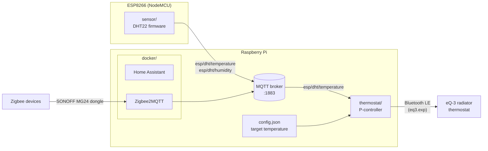

# smart-home

Home automation built around a Raspberry Pi and MQTT: a Wi-Fi room sensor reports
temperature and humidity, a controller on the Pi drives a Bluetooth radiator thermostat
to hold a target temperature, and a Docker stack runs Home Assistant and Zigbee2MQTT.

## Architecture

## Components

| Directory | What it is | Stack |
|---|---|---|
| [`sensor/`](sensor) | ESP8266 firmware: reads a DHT22 every 60 s and publishes temperature and humidity via MQTT; WebSocket status page and OTA updates | C++, PlatformIO, Arduino |
| [`thermostat/`](thermostat) | Subscribes to the room temperature and adjusts an eQ-3 Bluetooth radiator thermostat with a proportional controller | Python, paho-mqtt |
| [`docker/`](docker) | Docker Compose stack for the Pi: Home Assistant, Zigbee2MQTT, Watchtower, Portainer | Docker Compose |

Each directory has its own README with setup details.

## Getting started

1. Run an MQTT broker (e.g. Mosquitto) on the Pi. The broker is not part of the compose stack.
2. Start the services: `cd docker && docker compose up -d`.
3. Flash the sensor: copy `sensor/include/secrets.h.example` to `sensor/include/secrets.h`,
   fill in Wi-Fi credentials and the broker address, then `pio run -t upload`.
4. Start the controller on the Pi: `python thermostat/main_temp_ctrl.py`.

## History

This repository combines three earlier repositories, with their commit history preserved:
`raspberrypi-docker` → `docker/`, `Temperature-controll` → `thermostat/`, `ESP8266-DHT22` → `sensor/`.
