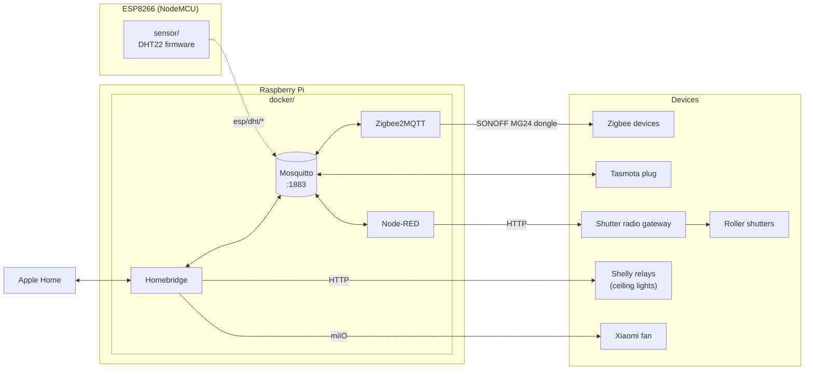

# smart-home

[](https://github.com/yuran-liang/smart-home/actions/workflows/ci.yml)

Home automation built around a Raspberry Pi and MQTT. A Docker stack runs the MQTT broker,
Zigbee2MQTT, Homebridge and Node-RED. Apple Home is the user interface: Homebridge
exposes the Zigbee lights, the ceiling-light relays, the roller shutters and a few other devices
to it, and Node-RED translates the shutter commands for their radio gateway.

## Architecture



- **Homebridge** is the only bridge to Apple Home. It reaches the Zigbee devices through
  Zigbee2MQTT (`homebridge-z2m`), the Tasmota plug and the roller shutters through MQTT, the
  Shelly relays over their HTTP API and the Xiaomi fan over miIO.
- **Roller shutters:** Homebridge publishes the target position to `curtain/<address>/set`; a
  Node-RED subflow turns it into an HTTP call to the radio gateway that drives the motors.
  Node-RED also holds room scenes that combine Zigbee lights and Shelly relays, and a dashboard
  for the sensor readings.
- **Not drawn:** Watchtower updates the container images daily, and Portainer is a web UI for
  Docker. The Roborock vacuum joins Apple Home directly over Matter and does not involve the Pi.
  The sensor is dashed because it is not deployed at the moment.

## Components

| Path | What it is | Stack |
|---|---|---|
| [`docker/`](docker) | Docker Compose stack for the Pi: Mosquitto, Zigbee2MQTT, Homebridge, Node-RED, Watchtower, Portainer | Docker Compose |
| [`sensor/`](sensor) | ESP8266 firmware: reads a DHT22 every 60 s and publishes temperature and humidity via MQTT; WebSocket status page and OTA updates. Not deployed at the moment | C++, PlatformIO, Arduino |
| [`scripts/`](scripts) | `deploy.sh`: deploys the pushed state of this repository and the service configs to the Pi | Bash |
| [`.github/workflows/`](.github/workflows) | CI: validates the Compose file, lints the shell scripts and builds the sensor firmware | GitHub Actions |

`docker/` and `sensor/` have their own READMEs with setup details.

## Getting started

1. Start the services: `cd docker && cp .env.example .env`, adjust `.env`, restore the service
   configs into `DATA_DIR` (see [`docker/README.md`](docker/README.md)), then `docker compose up -d`.
2. Flash the sensor: copy `sensor/include/secrets.h.example` to `sensor/include/secrets.h`,
   fill in Wi-Fi credentials and the broker address, then `pio run -t upload`.

## Deploying changes

The Pi runs the stack from a clone of this repository (`~/smart-home`, with `docker/.env`) next
to a clone of home-config, a separate private repository with the service configs and the
`export.py`/`restore.py` scripts that copy them to and from `DATA_DIR`. After a change is merged
into `main` of either repository, run from any machine with SSH access to the Pi (host `pi` by
default, override with `DEPLOY_HOST`) and a logged-in GitHub CLI:

```bash
scripts/deploy.sh --dry-run   # run the checks, list incoming commits with their CI status
scripts/deploy.sh             # pull both, restore configs, apply compose, restart changed services
```

It stops before writing anything when a live config differs from home-config, so a change made
in a web UI but never exported is not overwritten, and when CI has not passed on a commit it
would deploy.

CI runs on pull requests, on pushes to `main` and weekly, to catch dependencies that break
upstream. `main` is protected: changes go through a pull request with passing checks. CI never
deploys.

## History

This repository combines three earlier repositories, with their commit history preserved:
`raspberrypi-docker` → `docker/`, `Temperature-controll` → `thermostat/`, `ESP8266-DHT22` → `sensor/`.
`thermostat/` (an MQTT-driven controller for an eQ-3 Bluetooth radiator thermostat) was removed
after the move to underfloor heating; it remains in the history.

## License

[MIT](LICENSE)
