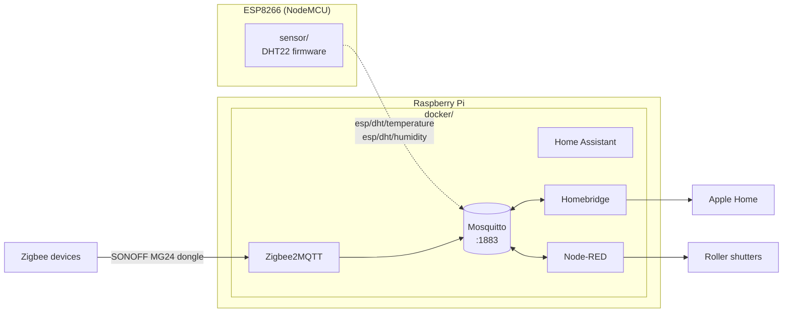

# smart-home

Home automation built around a Raspberry Pi and MQTT. A Docker stack runs the MQTT broker,
Home Assistant, Zigbee2MQTT, Homebridge and Node-RED: Zigbee devices come in through a SONOFF
dongle, Homebridge exposes them to Apple Home, and Node-RED drives the motorised roller shutters.

## Architecture



The sensor is drawn dashed because it is not deployed at the moment.

## Components

| Directory | What it is | Stack |
|---|---|---|
| [`sensor/`](sensor) | ESP8266 firmware: reads a DHT22 every 60 s and publishes temperature and humidity via MQTT; WebSocket status page and OTA updates. Not deployed at the moment | C++, PlatformIO, Arduino |
| [`docker/`](docker) | Docker Compose stack for the Pi: Mosquitto, Home Assistant, Zigbee2MQTT, Homebridge, Node-RED, Watchtower, Portainer | Docker Compose |

Each directory has its own README with setup details.

## Getting started

1. Start the services: `cd docker && cp .env.example .env`, adjust `.env`, restore the service
   configs into `DATA_DIR` (see [`docker/README.md`](docker/README.md)), then `docker compose up -d`.
2. Flash the sensor: copy `sensor/include/secrets.h.example` to `sensor/include/secrets.h`,
   fill in Wi-Fi credentials and the broker address, then `pio run -t upload`.

## Deploying changes

The Pi runs the stack from a clone of this repository (`~/smart-home`, with `docker/.env`) next
to a clone of home-config. After pushing to either repository, run from any machine with SSH
access to the Pi (host `pi` by default, override with `DEPLOY_HOST`):

```bash
scripts/deploy.sh --dry-run   # check for unexported live changes, list incoming commits
scripts/deploy.sh             # pull both, restore configs, apply compose, restart changed services
```

It stops before writing anything when a live config differs from home-config, so a change made
in a web UI but never exported is not overwritten. CI checks the Compose file, the shell scripts
and the sensor firmware build on every push; it does not deploy.

## History

This repository combines three earlier repositories, with their commit history preserved:
`raspberrypi-docker` → `docker/`, `Temperature-controll` → `thermostat/`, `ESP8266-DHT22` → `sensor/`.
`thermostat/` (an MQTT-driven controller for an eQ-3 Bluetooth radiator thermostat) was removed
after the move to underfloor heating; it remains in the history.
